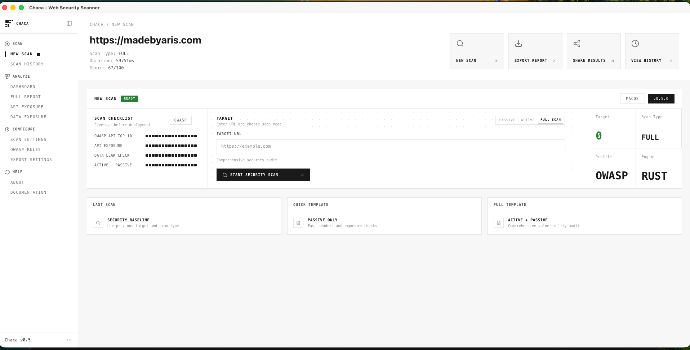
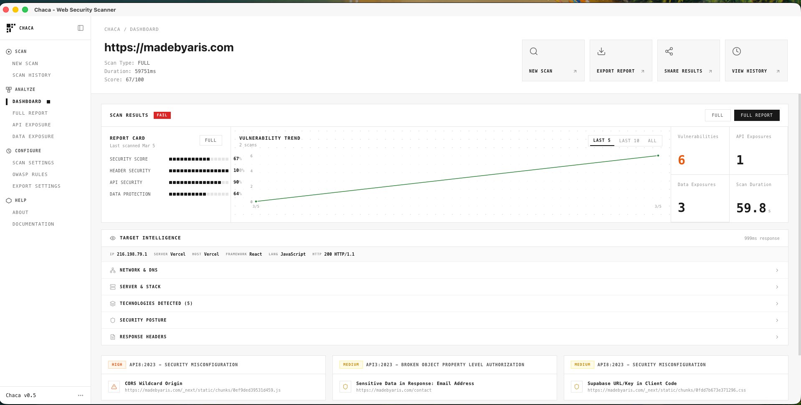
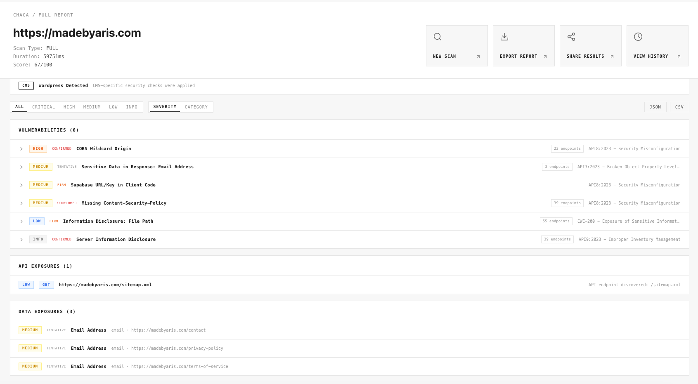

<p align="center">
  <strong>Chaca</strong> — Web Security Scanner
</p>
<p align="center">
  <em>A native desktop security scanner for vibe coders and developers</em>
</p>

<p align="center">
  
  
  
  
</p>

<p align="center">
  Fast, opinionated security audits of your web apps — no terminal required.
</p>

<p align="center">
  Chaca is <strong>free and open source</strong> (MIT). <a href="https://github.com/madebyaris/chaca-scanner">Star it on GitHub</a>, open an issue, or send a PR — every feature is available to everyone.
</p>

---

## Screenshots

| New Scan | Dashboard | Full Report |
|:--------:|:----------:|:-----------:|
| [](assets/home.png) | [](assets/detail.png) | [](assets/list-vuln.png) |
| Configure target URL and scan mode (Passive/Active/Full) | Security score, vulnerability counts, target intelligence | Filter by severity, CWE references, export to JSON/CSV/SARIF |

---

## What is Chaca?

**Chaca** = **Cha**lim S**ca**nner — a native desktop app built with **GPUI** and **Rust** that scans web applications for security issues. Designed for developers who want actionable results without learning Burp Suite or OWASP ZAP.

---

## Features

### Scanning Engine (Rust)

| Category | Capabilities |
|----------|--------------|
| **Passive** | Security headers, cookies, CORS, CSP, CSRF, clickjacking, JWT, rate limits, deserialization indicators, extended header checks (weak HSTS, `X-XSS-Protection`, `SameSite=None` without `Secure`) |
| **Active** | XSS (canary + attribute/event injection), SQLi, SSTI, open redirect, path traversal, CORS reflection, CSRF verification, method tampering (TRACE/XST), Host header injection |
| **CMS** | WordPress, Drupal, Joomla, Shopify, Magento fingerprinting + platform-specific checks |
| **API** | 57+ sensitive path probes (`/swagger.json`, `/env`, `/graphql`, `/wp-json/wp/v2/users`, …) |
| **Disclosure** | Stack traces, debug headers, file path leaks (Python, Java, PHP, .NET, Go, Ruby, Node.js) |
| **Services** | Supabase, Firebase, PocketBase, admin panels (phpMyAdmin, Adminer, wp-login, debug consoles) |
| **Recon** | IP, DNS (A/AAAA/MX/NS/SOA/TXT), TLS (protocol, issuer, SAN, expiry), server fingerprinting, tech detection (frameworks, CDNs, WAFs, hosting), `robots.txt` / `sitemap.xml` / `security.txt` |
| **Knowledge** | 50+ vulnerability definitions with CWE, CVSS severity, remediation, references |
| **Quality** | Confidence scoring (Confirmed/Firm/Tentative), deduplication, category-capped security score (0–100) |

### Desktop App (GPUI)

- Native window with live progress from crawl through the checks
- Dashboard with score, stats, and target intelligence
- Findings with severity filters, evidence, remediation, CWE, and references
- API exposure and data exposure views
- Export to JSON, CSV, and SARIF
- Session history for the scans finished in this run of the app

---

## Tech Stack

| Layer | Technology |
|-------|------------|
| Shell | GPUI 0.2 |
| Scanner | Rust (reqwest, regex, tokio, serde, tracing) |

---

## Getting Started

### Prerequisites

- [Rust](https://rustup.rs/) 1.77+
- On Linux, the Wayland or X11, fontconfig, and Vulkan libraries (`libwayland`, `libxkbcommon`, `libfontconfig`, `libvulkan`)

### Run

```bash
cargo run -p chaca-app
```

### Build

```bash
cargo build -p chaca-app --release
```

The binary is `target/release/chaca-app` (`chaca-app.exe` on Windows).

### Release (GitHub)

Pre-built binaries are published to [GitHub Releases](https://github.com/madebyaris/chaca-scanner/releases) on each version tag.

**To cut a release:**

1. Bump `version` in the workspace `Cargo.toml` and both crate manifests
2. Commit and push
3. Create and push a version tag: `git tag v0.9.0 && git push origin v0.9.0`
4. GitHub Actions builds macOS, Linux, and Windows and creates a draft release
5. Edit the draft release, add release notes, and publish

**Expected artifacts:**

| Platform | Artifact |
|----------|----------|
| macOS (Apple Silicon) | `chaca-macos-aarch64` |
| Linux (x64) | `chaca-linux-x64` |
| Windows (x64) | `chaca-windows-x64.exe` |

Releases are unsigned. Windows may show a security warning. On macOS, if Gatekeeper blocks the download, clear the quarantine flag and open the binary again:

```bash
xattr -d com.apple.quarantine ./chaca-macos-aarch64
```

Ensure **Settings → Actions → General → Workflow permissions** is set to "Read and write permissions" so the release workflow can create releases.

---

## Usage

### URL Scan
1. Enter a target URL
2. Choose **Passive** or **Full** scan
3. Review dashboard — score, vulnerabilities, target intelligence
4. Open findings for evidence, remediation, CWE references
5. Export as JSON, CSV, or SARIF

> **Only scan targets you have explicit permission to test.**

---

## Project Structure

```
crates/chaca-app/       # GPUI desktop window
crates/chaca-core/      # Scanner engine
└── src/scanner/
    ├── engine.rs           # Scan orchestrator
    ├── crawler.rs          # URL discovery
    ├── folder_scanner.rs   # Local folder scan
    ├── passive.rs          # Passive checks
    ├── active.rs           # Active tests
    ├── cms.rs              # CMS detection
    ├── recon.rs            # Target intelligence
    └── rules/              # Advisories, exposure, disclosure, services
```

---

## Support

Chaca is **100% free and open source** under the [MIT license](LICENSE). Every feature in the app is available to everyone. No license keys, no subscriptions, no feature gates.

You can still support the project if you like:

- Star or sponsor the repo: [github.com/madebyaris](https://github.com/madebyaris)
- PayPal: `arissetia.m@gmail.com`

---

## Author

**Aris Setiawan**

- [madebyaris.com](https://madebyaris.com)
- [GitHub @madebyaris](https://github.com/madebyaris)
- [X @arisberikut](https://x.com/arisberikut)

---

<p align="center">
  <sub>Open-source. Use responsibly.</sub>
</p>
